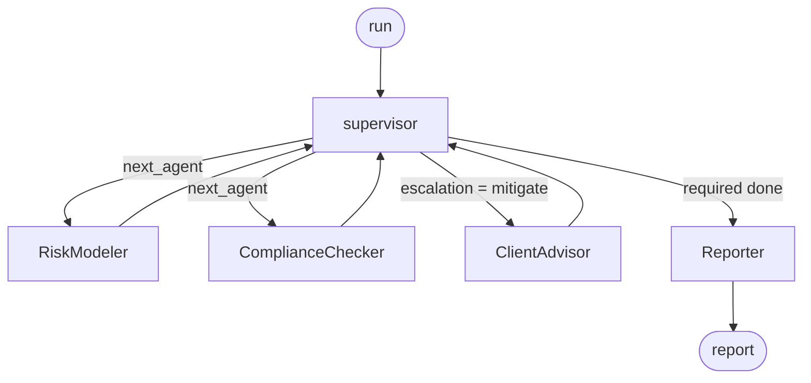

<div dir="rtl" markdown="1">

# OrchestratorX — أوركستريتور إكس

**إطار عمل متعدد الوكلاء بنمط المشرف، يكون فيه التوجيه ثابتًا قابلًا للإثبات لا موجّهًا نصيًّا.**

الوكلاء المتخصّصون ينفّذون العمل، ومشرف واحد يقرّر مَن يعمل تاليًا، وما الذي يجب فعله حيال ما
وجدوه، ومتى يتوقّف. وتُسجَّل كل قفزة في أثر تدقيق مُرتّب — بما في ذلك القفزات التي فشلت.

يعمل دون اتصال: لا مفاتيح واجهات برمجية، ولا شبكة، ولا حسابات.

*[English](./README.md) · [المواصفة](./SPEC.md)*

---

## الفكرة

تضع معظم الأنظمة متعدّدة الوكلاء منطق التوجيه داخل الموجّه النصّي. وهذا يجعل أهمّ سلوك في
النظام — مَن يعمل، وبأيّ ترتيب، وماذا يحدث حين يسوء شيء ما — غير قابل للاختبار دون نموذج حيّ.

يُخرج OrchestratorX التوجيه من الموجّه النصّي ويضعه في حالة مُنمّطة:

```python
def next_hop(state, breaker=None) -> str:
    if state.get("halted"):
        return REPORTER
    for agent in REQUIRED_SPECIALISTS:
        if agent not in state["visited"] and not breaker.is_open(agent):
            return agent
    ...
```

ولأنّ هذه الدالة لا تستشير أيّ نموذج، يصبح الاختبار التالي قابلًا للتشغيل في التكامل المستمر
خلال أجزاء من الألف من الثانية:

```python
def test_compliance_checker_is_never_skipped_on_the_happy_path():
    ...
    assert seen.index("ComplianceChecker") < seen.index(REPORTER)
```

ويبقى النموذج اللغوي مسؤولًا عن صياغة السرد الموجّه للعميل، لكنّه لا يقرّر أبدًا ما إذا كانت
المحفظة ملتزمة.

---

## البدء السريع

```bash
git clone https://github.com/asadullah48/orchestratorx && cd orchestratorx
python -m venv .venv && .venv/Scripts/pip install -e ".[dev]"
.venv/Scripts/python -m orchestratorx.cli demo
```

مخرجات حقيقية:

```
[1] Compliant book
    path       : supervisor -> RiskModeler -> supervisor -> ComplianceChecker -> supervisor -> Reporter
    escalation : continue  |  halted: False
    findings   : none

[2] Concentrated and over-levered
    path       : supervisor -> RiskModeler -> supervisor -> ComplianceChecker -> supervisor -> ClientAdvisor -> supervisor -> Reporter
    escalation : continue  |  halted: False
    findings   : RSK-001(medium), CMP-002(high), CMP-002(high), CMP-004(high)

[3] Restricted sector held
    path       : supervisor -> RiskModeler -> supervisor -> ComplianceChecker -> supervisor -> Reporter
    escalation : halt  |  halted: True
    findings   : CMP-003(critical)
```

لاحظ التشغيل الثاني: وجّهت النتائج عالية الخطورة المسار إلى `ClientAdvisor` **مرّة واحدة
فقط**، ثم أعاد العدّاد المحدود التصعيد إلى `continue` فانتهى التشغيل. أمّا التشغيل الثالث فلم
يبلغ المستشار إطلاقًا، إذ إنّ المخالفة الحرجة توقف التشغيل بدل البحث عن تخفيف لها.

---

## الرسم البياني



| الوكيل | مهمّته |
|---|---|
| **supervisor** | العقدة الوحيدة التي توجّه. تقرأ الحالة المُنمّطة وتختار القفزة التالية وتفرض الانتقالات المشروعة. |
| **RiskModeler** | يُقدّر التعرّض: التركّز، ومزيج القطاعات، والتقلّب المعدّل بالرافعة. يُبلّغ بالأرقام لا بالأحكام. |
| **ComplianceChecker** | يطبّق قواعد التفويض. وهنا تُصبح درجة الخطورة ذات أثر فعلي. |
| **ClientAdvisor** | يقترح إجراءات التخفيف، ولا يُبلَغ إلّا حين يطلب التصعيد ذلك. ولا يُسقط أيّ نتيجة بسلطته الذاتية. |
| **Reporter** | العقدة النهائية. يجمع المُخرَج، أو يوضّح سبب حجبه. |

يعود المتخصّصون **إلى المشرف فقط**، ولا يسلّم أحدهم إلى الآخر. وهذا ما يُبقي كل قرار توجيه في
دالة واحدة قابلة للاختبار.

---

## ثلاثة أمور تُمسك البنية معًا

**المُخفِّضات، لأنّ الرسم البياني يدور.** المسار `supervisor → specialist → supervisor` يعيد
زيارة العقد، فأي حقل يُكتب أكثر من مرّة يحتاج إلى `Annotated[list, operator.add]`. وبدون ذلك
يمحو كل متخصّص نتائج سابقه بصمت.

**ميزانية قفزات، لا مجرّد سقف لإعادة المحاولة.** إعادة المحاولة تحدّ من إخفاقات عقدة واحدة،
أمّا **الدورة** فلا يحدّها إلّا ميزانية. وإلّا فإنّ "العودة للتخفيف ثم إعادة الفحص" حلقة لا
نهائية مشروعة لا يُسيء أيّ مكوّن التصرّف لإحداثها.

**عزل لكل تشغيل.** يُبحث عن الأثر وقاطع الدارة بمعرّف التشغيل `run_id` ولا يُحفظان على الكائن،
فلا تتسرّب عدادات الإخفاق بين التشغيلات المتزامنة على رسم بياني واحد مُصرَّف. وهناك اختبار
لهذا تحديدًا.

---

## سياسة التصعيد

المتخصّصون يُبلّغون بالوقائع، وما يفعله المشرف حيالها موقف من المخاطر، معزول في دالة واحدة
موسومة بـ `=== ESCALATION SEAM ===` في `policy.py`:

| أخطر نتيجة | الإجراء | السبب |
|---|---|---|
| `critical` | **إيقاف** | التقرير المبني على مخالفة حرجة أسوأ من غياب التقرير، لأنّه يبدو ذا حجّية. |
| `high` | **تخفيف** مرّة واحدة | التوجيه إلى ClientAdvisor لاقتراح تخفيف ثم إعادة الفحص، محدودًا بحيث تنتهي الدورة يقينًا. |
| `medium` فأقلّ | **متابعة** | التوثيق ثم إصدار التقرير. |

يمكن عكسها في دالة واحدة دون المساس بالتوجيه أو الموثوقية أو أيّ وكيل.

---

## الموثوقية

| الإخفاق | السلوك |
|---|---|
| خطأ عابر في متخصّص | يُعاد حتى `max_attempts`، ويكتمل التشغيل ويُسجَّل عدد المحاولات |
| إخفاق متكرّر | يُفتح القاطع، ويوجّه المشرف المسار حوله، ويُسجَّل الخطأ في الأثر |
| انتقال غير مشروع | `PolicyViolationError`، **ولا يُعاد أبدًا** لأنّ إعادة خطأ حتمي تُعيد إنتاجه |
| دورة جامحة | `BudgetExceededError` عند `MAX_HOPS`، وينتهي التشغيل عند المُبلِّغ |

فلا يستطيع متخصّص مُخفق أن يُعلّق التشغيل، أو يختفي من السجلّ، أو يُنتج تقريرًا نظيفًا.

---

## واجهة HTTP

```bash
pip install -e ".[api]"
uvicorn orchestratorx.api:app --reload
```

| المسار | الغرض |
|---|---|
| `GET /health` | الإصدار والمُستدِل النشط والسياسة السارية |
| `POST /run` | تشغيل تنسيق وإرجاع النتائج والتقرير |
| `GET /trace/{run_id}` | استرجاع ما فعله ذلك التشغيل بالضبط، قفزةً قفزة |

والمسار الثالث هو بيت القصيد: المنسّق الذي لا يمكن استجوابه لاحقًا ليس قابلًا للتدقيق مهما
كان تسجيله جيّدًا.

---

## التطوير

```bash
.venv/Scripts/python -m pytest      # 41 اختبارًا
.venv/Scripts/python -m ruff check .
```

```
src/orchestratorx/
  state.py         الحالة المُنمّطة والمُخفِّضات وFinding / AgentResult
  policy.py        التوجيه وإعادة المحاولة وقاطع الدارة ودرز التصعيد
  agents.py        RiskModeler و ComplianceChecker و ClientAdvisor و Reporter
  orchestrator.py  عقدة المشرف وتركيب الرسم البياني
  trace.py         أثر التدقيق المُرتّب
  llm.py           FakeLLM افتراضيًّا، مع Claude / Gemini اختياريًّا
  api.py           خدمة FastAPI
  cli.py           نقطة دخول سطر الأوامر
```

---

## الحالة والحدود

تنفيذ مرجعي، وحدوده مقصودة: لا مصادقة، ولا تخزين دائم (سجلّ الأثر داخل العملية، و`write_json`
هو درز التصدير)، ولا بثّ، وقواعد المجال تفويض معقول لا تفويض حقيقي. وكل بيانات العملاء
والمُصدرين والسوق اصطناعية.

## الرخصة

MIT

</div>
