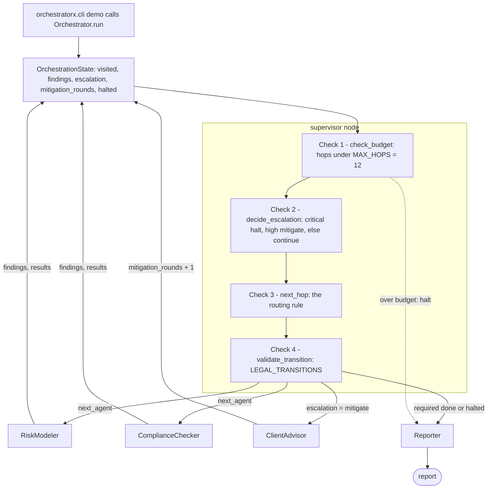
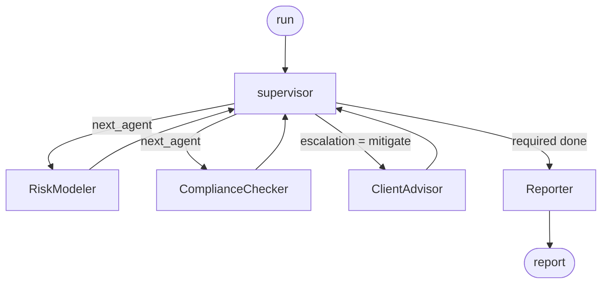

# OrchestratorX

[](https://github.com/asadullah48/orchestratorx/actions/workflows/ci.yml)

Supervisor-pattern multi-agent framework — routing as typed state, not prompt text.

## The problem

In many multi-agent systems, a model decides which agent runs next by following
instructions in a prompt. Then the most important behaviour — who runs, in what order, and
when to stop — can only be checked by running a live model, and a wrong route is hard to
reproduce. OrchestratorX keeps that decision in one plain Python function, `next_hop`, that
reads typed state, so routing is tested in CI like any other code.

## Demo

https://github.com/user-attachments/assets/252dedbc-52a7-4372-a93f-f0b32720854e

*An animated diagram of the design, using the route, field names and values from demo run 2
("Concentrated and over-levered"). It explains the design; it is not a recording of a run
([docs/video](./docs/video/README.md)). A screen recording of a live run is coming.*

## Quick start

Runs offline: no API keys, no network, no accounts. The default reasoner is a deterministic
`FakeLLM`. Needs Python 3.11 or newer.

**Windows (PowerShell)**

```powershell
git clone https://github.com/asadullah48/orchestratorx
cd orchestratorx
python -m venv .venv
.venv\Scripts\python -m pip install -e .
.venv\Scripts\python -m orchestratorx.cli demo
```

**macOS / Linux**

```bash
git clone https://github.com/asadullah48/orchestratorx
cd orchestratorx
python3 -m venv .venv
.venv/bin/python -m pip install -e .
.venv/bin/python -m orchestratorx.cli demo
```

## What you will see

Three portfolios go through the supervisor. The real output of the three runs:

```
[1] Compliant book
    Nothing to escalate; straight through to the report.
    path       : supervisor -> RiskModeler -> supervisor -> ComplianceChecker -> supervisor -> Reporter
    escalation : continue  |  halted: False
    findings   : none
    hops       : 6 (budget 12)

[2] Concentrated and over-levered
    High findings trigger one bounded mitigation round via ClientAdvisor.
    path       : supervisor -> RiskModeler -> supervisor -> ComplianceChecker -> supervisor -> ClientAdvisor -> supervisor -> Reporter
    escalation : continue  |  halted: False
    findings   : RSK-001(medium), CMP-002(high), CMP-002(high), CMP-004(high)
    hops       : 8 (budget 12)

[3] Restricted sector held
    A critical breach halts the run; the report is withheld rather than dressed up.
    path       : supervisor -> RiskModeler -> supervisor -> ComplianceChecker -> supervisor -> Reporter
    escalation : halt  |  halted: True
    findings   : CMP-003(critical)
    hops       : 6 (budget 12)
```

## How it works



The routing rule, `next_hop` in [`policy.py`](./src/orchestratorx/policy.py), checks in this order:

1. If `halted` is true, go to `Reporter`.
2. Otherwise, go to the first of `RiskModeler`, `ComplianceChecker` that is not yet in `visited` (skipping one whose circuit breaker is open).
3. Otherwise, if `escalation` is `mitigate` and `mitigation_rounds` is below `MAX_MITIGATION_ROUNDS` (1), and the `ClientAdvisor` breaker is not open, go to `ClientAdvisor`.
4. Otherwise, go to `Reporter`.

**Tests:** 70 passing (`pytest -q` after a clean `pip install -e ".[dev,api]"`, verified
9 Nov 2026, code commit 8ff9f8c). CI runs them on Python 3.11, 3.12 and 3.13.

*[العربية](./README.ar.md) · [Specification](./SPEC.md)*

---

## Why routing lives in code

**A supervisor-pattern multi-agent framework where routing is an invariant, not a prompt.**

Specialist agents do the work. One supervisor decides who runs next, what to do about what
they found, and when to stop. Every hop lands in an ordered audit trace — including the
ones that failed.

Most multi-agent systems put routing inside a prompt. That makes the most important
behaviour in the system — who runs, in what order, and what happens when something goes
wrong — untestable without a live model.

OrchestratorX pulls routing out of the prompt and into typed state:

Simplified from `_route()` in [`policy.py`](./src/orchestratorx/policy.py) (rule IDs left out):

```python
def next_hop(state, breaker=None) -> str:
    if state.get("halted"):
        return REPORTER
    for agent in REQUIRED_SPECIALISTS:
        if agent in state.get("visited", []):
            continue
        if breaker is not None and breaker.is_open(agent):
            continue
        return agent
    ...
```

Because that function consults no model, this is a test that runs in CI in milliseconds:

```python
def test_compliance_checker_is_never_skipped_on_the_happy_path():
    ...
    assert seen.index("ComplianceChecker") < seen.index(REPORTER)
```

The LLM still writes the client-facing narrative. It just never decides whether a
portfolio is compliant.

---

## Demo walkthrough

Set up first with the Quick start above. The output of all three runs is under
[What you will see](#what-you-will-see).

Note run 2: the HIGH findings routed to `ClientAdvisor` **exactly once**, then the bounded
counter flipped escalation back to `continue` and it terminated. Run 3 never reached the
advisor at all — a critical breach halts rather than shopping for a mitigation.

---

## Graph shape (`orchestratorx graph`)



| Agent | Job |
|---|---|
| **supervisor** | The only node that routes. Reads typed state, picks the next hop, enforces legal transitions. |
| **RiskModeler** | Quantifies exposure — concentration, sector mix, leverage-adjusted volatility. Reports numbers, not verdicts. |
| **ComplianceChecker** | Applies mandate rules. This is where severity bites. |
| **ClientAdvisor** | Proposes mitigations. Reached only when escalation asks. Never clears a finding on its own authority. |
| **Reporter** | Terminal node. Assembles the deliverable, or explains why it was withheld. |

Specialists return **only** to the supervisor — never to each other. That is what keeps
every routing decision in one testable function.

---

## Three things that make it hold together

**Reducers, because the graph loops.** `supervisor → specialist → supervisor` revisits
nodes, so any field written more than once needs `Annotated[list, operator.add]`. Without
that, each specialist silently overwrites the previous one's findings.

**A hop budget, not just a retry cap.** Retries bound one node's failures; only a budget
bounds the *cycle*. "Route back for mitigation, then re-check" is otherwise a legal
infinite loop that no single component is misbehaving to cause.

**Per-run isolation.** The trace and circuit breaker are looked up by `run_id`, not held on
the instance, so concurrent runs on one compiled graph cannot leak failure counts into each
other. There is a test for exactly that.

---

## Escalation policy

Specialists report facts. What the supervisor *does* about them is a risk posture, isolated
in one function marked `=== ESCALATION SEAM ===` in `policy.py`:

| Worst finding | Action | Why |
|---|---|---|
| `critical` | **halt** | A report built on a critical breach is worse than no report — it looks authoritative. |
| `high` | **mitigate**, once | Route to ClientAdvisor for a proposal, then re-check. Bounded so the cycle provably terminates. |
| `medium` or lower | **continue** | Annotate and report. |

Invert it in one function without touching routing, reliability, or any agent. A regulated
desk might halt on `high` too; a research desk might allow several mitigation rounds.

---

## Reliability

| Failure | Behaviour |
|---|---|
| Transient specialist error | Retried up to `max_attempts`; the run completes and `attempts` is recorded |
| Repeated specialist failure | Circuit opens, supervisor routes around it, the error lands in the trace |
| Illegal transition | `PolicyViolationError`, **never retried** — retrying a deterministic error reproduces it |
| Runaway cycle | `BudgetExceededError` at `MAX_HOPS`, run ends at the Reporter |

A failing specialist can't hang the run, vanish from the record, or produce a clean report.

---

## HTTP API

```bash
pip install -e ".[api]"
uvicorn orchestratorx.api:app --reload
```

| Endpoint | Purpose |
|---|---|
| `GET /health` | Version, active reasoner, policy in force |
| `POST /run` | Run an orchestration, return findings and the report |
| `GET /trace/{run_id}` | Read back exactly what that run did, hop by hop |

The third endpoint is the point. An orchestrator you can't interrogate after the fact
isn't auditable, however good its logging is.

---

## Commands

| Command | Does |
|---|---|
| `orchestratorx demo` | Three portfolios through the supervisor |
| `orchestratorx demo --reports` | Same, with full report text |
| `orchestratorx demo --trace-out t.json` | Export the last run's trace |
| `orchestratorx demo --trace` | Write each run's route trace (the rule that fired and the inputs it read, per hop) to `traces/<run_id>.json` and `traces/<run_id>.mmd` in the current directory |
| `orchestratorx graph` | Print the graph as mermaid |
| `orchestratorx policy` | Print the routing and escalation policy in force |

Sample route-trace output, unedited: [`docs/samples/`](./docs/samples/) (`.json` and `.mmd`).
How this routing compares to a plain LangGraph conditional edge:
[`docs/typed-state-routing.md`](./docs/typed-state-routing.md).

---

## Optional model backends

Deterministic `FakeLLM` by default. To use a real model for the narrative only:

```bash
ORCHESTRATORX_LLM=claude ANTHROPIC_API_KEY=... orchestratorx demo
ORCHESTRATORX_LLM=gemini GOOGLE_API_KEY=...    orchestratorx demo
```

Anything unavailable degrades to `FakeLLM` rather than raising. A missing key costs prose
quality, never a failed run.

---

## Development

```bash
.venv/Scripts/python -m pytest      # 70 tests passing (verified 9 Nov 2026, code commit 8ff9f8c)
.venv/Scripts/python -m ruff check .
```

```
src/orchestratorx/
  state.py         typed state, reducers, Finding / AgentResult
  policy.py        routing, retry, circuit breaker, escalation seam
  agents.py        RiskModeler, ComplianceChecker, ClientAdvisor, Reporter
  orchestrator.py  supervisor node + graph assembly
  trace.py         ordered audit trail
  route_trace.py   route trace: the rule and inputs behind each supervisor decision
  errors.py        failure taxonomy (retryable vs not)
  llm.py           FakeLLM default, optional Claude / Gemini
  api.py           FastAPI service
  cli.py           command-line entry point
```

---

## Status and limits

A reference implementation, and the boundaries are deliberate: no auth, no persistence
(the trace registry is in-process; traces are written to disk only by `RunTrace.write_json`
and `RouteTrace.write()`), no streaming, and the domain rules are a plausible mandate rather than
a real one. All client, issuer, and market data is synthetic.

**Route traces.** With `trace_routes=True`, `Orchestrator.route_traces` keeps one entry per
run and never prunes it. Code that uses the library directly and traces many runs must pop
entries itself (documented in `orchestrator.py`; the CLI does this). If writing a trace fails,
the trace stays in memory, and the run's own error is still the one raised.

**Not tested:** runs with real Claude or Gemini keys, the HTTP server (only its import is
checked in CI), video rendering, and a run with the network cut off.

## 🤖 Agentic AI Alignment

- **Autonomy** — the supervisor decides who runs next and when to stop
  from typed state and the run's circuit breaker (`next_hop()`), not from a prompt — routing is a
  testable function, not a hope about what the model will do.
- **Resilience** — a hop budget bounds the *cycle* (not just per-node
  retries), per-run isolation keeps concurrent runs' circuit breakers from
  leaking into each other, and a `PolicyViolationError` is never retried
  because retrying a deterministic error just reproduces it.
- **Adaptivity** — the escalation policy (`=== ESCALATION SEAM ===` in
  `policy.py`) is one function you can invert without touching routing,
  reliability, or any agent — a regulated desk halts on `high`, a research
  desk allows more mitigation rounds, same graph either way.

### Roadmap

- Add a persistence layer for the trace registry (currently in-process,
  with `RunTrace.write_json` and `RouteTrace.write()` as the export seams) so runs
  survive a restart.
- Extend the `FakeLLM`/Claude/Gemini backend seam to more providers, since
  the routing/reliability guarantees are already backend-agnostic.

## 🤖 Author

Built by **Asadullah Shafique**.

🔗 Explore my portfolio showcasing Agentic AI projects and real-world applications: [asadullahshafique-devunity.vercel.app](https://asadullahshafique-devunity.vercel.app)

## License

MIT
