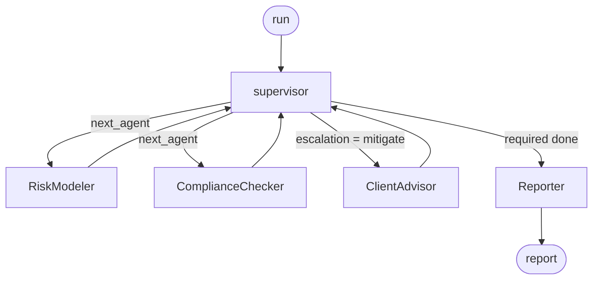

# OrchestratorX

[](https://github.com/asadullah48/orchestratorx/actions/workflows/ci.yml)

**A supervisor-pattern multi-agent framework where routing is an invariant, not a prompt.**

Specialist agents do the work. One supervisor decides who runs next, what to do about what
they found, and when to stop. Every hop lands in an ordered audit trace — including the
ones that failed.

Runs offline: no API keys, no network, no accounts.

*[العربية](./README.ar.md) · [Specification](./SPEC.md)*

---

## The idea

Most multi-agent systems put routing inside a prompt. That makes the most important
behaviour in the system — who runs, in what order, and what happens when something goes
wrong — untestable without a live model.

OrchestratorX pulls routing out of the prompt and into typed state:

```python
def next_hop(state, breaker=None) -> str:
    if state.get("halted"):
        return REPORTER
    for agent in REQUIRED_SPECIALISTS:
        if agent not in state["visited"] and not breaker.is_open(agent):
            return agent
    ...
```

Because that function consults no model, this is a test that runs in CI in milliseconds:

```python
def test_compliance_checker_is_never_skipped_on_the_happy_path():
    ...
    assert seen.index("ComplianceChecker") < seen.index(REPORTER)
```

The LLM still writes the client-facing narrative. It just never decides whether a
portfolio is compliant.

---

## Quickstart

```bash
git clone https://github.com/asadullah48/orchestratorx && cd orchestratorx
python -m venv .venv && .venv/Scripts/pip install -e ".[dev]"
.venv/Scripts/python -m orchestratorx.cli demo
```

Real output:

```
[1] Compliant book
    path       : supervisor -> RiskModeler -> supervisor -> ComplianceChecker -> supervisor -> Reporter
    escalation : continue  |  halted: False
    findings   : none

[2] Concentrated and over-levered
    path       : supervisor -> RiskModeler -> supervisor -> ComplianceChecker -> supervisor -> ClientAdvisor -> supervisor -> Reporter
    escalation : continue  |  halted: False
    findings   : RSK-001(medium), CMP-002(high), CMP-002(high), CMP-004(high)

[3] Restricted sector held
    path       : supervisor -> RiskModeler -> supervisor -> ComplianceChecker -> supervisor -> Reporter
    escalation : halt  |  halted: True
    findings   : CMP-003(critical)
```

Note run 2: the HIGH findings routed to `ClientAdvisor` **exactly once**, then the bounded
counter flipped escalation back to `continue` and it terminated. Run 3 never reached the
advisor at all — a critical breach halts rather than shopping for a mitigation.

---

## The graph



| Agent | Job |
|---|---|
| **supervisor** | The only node that routes. Reads typed state, picks the next hop, enforces legal transitions. |
| **RiskModeler** | Quantifies exposure — concentration, sector mix, leverage-adjusted volatility. Reports numbers, not verdicts. |
| **ComplianceChecker** | Applies mandate rules. This is where severity bites. |
| **ClientAdvisor** | Proposes mitigations. Reached only when escalation asks. Never clears a finding on its own authority. |
| **Reporter** | Terminal node. Assembles the deliverable, or explains why it was withheld. |

Specialists return **only** to the supervisor — never to each other. That is what keeps
every routing decision in one testable function.

---

## Three things that make it hold together

**Reducers, because the graph loops.** `supervisor → specialist → supervisor` revisits
nodes, so any field written more than once needs `Annotated[list, operator.add]`. Without
that, each specialist silently overwrites the previous one's findings.

**A hop budget, not just a retry cap.** Retries bound one node's failures; only a budget
bounds the *cycle*. "Route back for mitigation, then re-check" is otherwise a legal
infinite loop that no single component is misbehaving to cause.

**Per-run isolation.** The trace and circuit breaker are looked up by `run_id`, not held on
the instance, so concurrent runs on one compiled graph cannot leak failure counts into each
other. There is a test for exactly that.

---

## Escalation policy

Specialists report facts. What the supervisor *does* about them is a risk posture, isolated
in one function marked `=== ESCALATION SEAM ===` in `policy.py`:

| Worst finding | Action | Why |
|---|---|---|
| `critical` | **halt** | A report built on a critical breach is worse than no report — it looks authoritative. |
| `high` | **mitigate**, once | Route to ClientAdvisor for a proposal, then re-check. Bounded so the cycle provably terminates. |
| `medium` or lower | **continue** | Annotate and report. |

Invert it in one function without touching routing, reliability, or any agent. A regulated
desk might halt on `high` too; a research desk might allow several mitigation rounds.

---

## Reliability

| Failure | Behaviour |
|---|---|
| Transient specialist error | Retried up to `max_attempts`; the run completes and `attempts` is recorded |
| Repeated specialist failure | Circuit opens, supervisor routes around it, the error lands in the trace |
| Illegal transition | `PolicyViolationError`, **never retried** — retrying a deterministic error reproduces it |
| Runaway cycle | `BudgetExceededError` at `MAX_HOPS`, run ends at the Reporter |

A failing specialist can't hang the run, vanish from the record, or produce a clean report.

---

## HTTP API

```bash
pip install -e ".[api]"
uvicorn orchestratorx.api:app --reload
```

| Endpoint | Purpose |
|---|---|
| `GET /health` | Version, active reasoner, policy in force |
| `POST /run` | Run an orchestration, return findings and the report |
| `GET /trace/{run_id}` | Read back exactly what that run did, hop by hop |

The third endpoint is the point. An orchestrator you can't interrogate after the fact
isn't auditable, however good its logging is.

---

## Commands

| Command | Does |
|---|---|
| `orchestratorx demo` | Three portfolios through the supervisor |
| `orchestratorx demo --reports` | Same, with full report text |
| `orchestratorx demo --trace-out t.json` | Export the last run's trace |
| `orchestratorx graph` | Print the graph as mermaid |
| `orchestratorx policy` | Print the routing and escalation policy in force |

---

## Optional model backends

Deterministic `FakeLLM` by default. To use a real model for the narrative only:

```bash
ORCHESTRATORX_LLM=claude ANTHROPIC_API_KEY=... orchestratorx demo
ORCHESTRATORX_LLM=gemini GOOGLE_API_KEY=...    orchestratorx demo
```

Anything unavailable degrades to `FakeLLM` rather than raising. A missing key costs prose
quality, never a failed run.

---

## Development

```bash
.venv/Scripts/python -m pytest      # 41 tests passing (verified 24 Oct 2026, commit 1ca950a)
.venv/Scripts/python -m ruff check .
```

```
src/orchestratorx/
  state.py         typed state, reducers, Finding / AgentResult
  policy.py        routing, retry, circuit breaker, escalation seam
  agents.py        RiskModeler, ComplianceChecker, ClientAdvisor, Reporter
  orchestrator.py  supervisor node + graph assembly
  trace.py         ordered audit trail
  llm.py           FakeLLM default, optional Claude / Gemini
  api.py           FastAPI service
  cli.py           command-line entry point
```

---

## Status and limits

A reference implementation, and the boundaries are deliberate: no auth, no persistence
(the trace registry is in-process, with `write_json` as the export seam), no streaming, and
the domain rules are a plausible mandate rather than a real one. All client, issuer, and
market data is synthetic.

## 🤖 Agentic AI Alignment

- **Autonomy** — the supervisor decides who runs next and when to stop
  from typed state alone (`next_hop()`), not from a prompt — routing is a
  testable function, not a hope about what the model will do.
- **Resilience** — a hop budget bounds the *cycle* (not just per-node
  retries), per-run isolation keeps concurrent runs' circuit breakers from
  leaking into each other, and a `PolicyViolationError` is never retried
  because retrying a deterministic error just reproduces it.
- **Adaptivity** — the escalation policy (`=== ESCALATION SEAM ===` in
  `policy.py`) is one function you can invert without touching routing,
  reliability, or any agent — a regulated desk halts on `high`, a research
  desk allows more mitigation rounds, same graph either way.

### Roadmap

- Add a persistence layer for the trace registry (currently in-process,
  with `write_json` as the only export seam) so runs survive a restart.
- Extend the `FakeLLM`/Claude/Gemini backend seam to more providers, since
  the routing/reliability guarantees are already backend-agnostic.

## 🤖 Author

Built by **Asadullah Shafique**.

🔗 Explore my portfolio showcasing Agentic AI projects and real-world applications: [asadullahshafique-devunity.vercel.app](https://asadullahshafique-devunity.vercel.app)

## License

MIT
