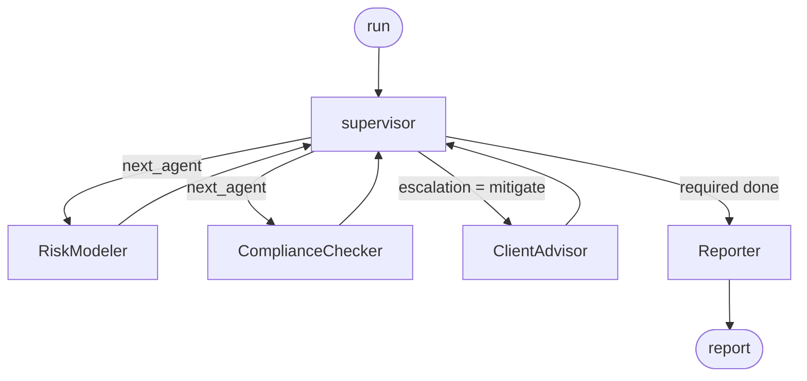

# OrchestratorX Specification

**Version 0.1.0** · Status: reference implementation · Audience: platform and risk engineers

---

## 1. Problem

A multi-agent system has to answer four questions: who runs next, what happens when a
specialist finds something, what happens when one fails, and how you prove afterwards what
actually occurred.

The common answer puts all four inside a prompt. That makes them untestable without a live
model, non-deterministic across runs, and unprovable to a reviewer. OrchestratorX moves all
four into typed state and plain Python, and leaves the model the one job it is actually
best at: writing the narrative a human reads.

---

## 2. Design invariants

| # | Invariant | Enforced by |
|---|---|---|
| I1 | Only the supervisor routes | `LEGAL_TRANSITIONS` — specialists may return **only** to `supervisor` |
| I2 | Required specialists always run before a report | `next_hop` scans `REQUIRED_SPECIALISTS` before considering `Reporter` |
| I3 | Every run terminates | `MAX_HOPS` budget + `MAX_MITIGATION_ROUNDS` bound on the cycle |
| I4 | Every hop is recorded | Node wrappers call `RunTrace.record` on success *and* failure |
| I5 | Routing never consults a model | `next_hop` / `decide_escalation` take state and findings only |
| I6 | Concurrent runs are isolated | Trace and breaker looked up by `run_id`, not held on the instance |

Each has a test in `tests/`. I5 is what makes I1–I3 assertable in CI at all.

---

## 3. State contract

`OrchestrationState` is a `TypedDict` with reducers, defined in `state.py`.

| Field | Type | Merge | Purpose |
|---|---|---|---|
| `run_id` | `str` | last-write | Correlates state, trace, and breaker |
| `objective` | `str` | last-write | What this run is for |
| `request` | `dict` | last-write | Domain payload |
| `next_agent` | `str` | last-write | Conditional-edge target |
| `visited` | `list[str]` | **`operator.add`** | Append-only hop record |
| `results` | `list[dict]` | **`operator.add`** | One `AgentResult` per specialist call |
| `findings` | `list[dict]` | **`operator.add`** | Accumulated across specialists |
| `errors` | `list[dict]` | **`operator.add`** | Non-fatal failures |
| `escalation` | `str` | last-write | `continue` \| `mitigate` \| `halt` |
| `mitigation_rounds` | `int` | last-write (read-modify-write) | Bounds the cycle |
| `halted` | `bool` | last-write | Set by a `critical` finding |
| `report` | `str` | last-write | Terminal output |

**Why reducers matter here.** The graph loops. A field written on more than one visit needs
`Annotated[list, operator.add]`, or the second specialist silently overwrites the first
one's findings. `mitigation_rounds` is a scalar and is therefore incremented with an
explicit read-modify-write inside the node.

---

## 4. Graph



Adjacency (`policy.LEGAL_TRANSITIONS`):

| From | May go to |
|---|---|
| `supervisor` | `RiskModeler`, `ComplianceChecker`, `ClientAdvisor`, `Reporter` |
| any specialist | `supervisor` only |
| `Reporter` | terminal |

`validate_transition(src, dst)` raises `PolicyViolationError` on anything else. The
supervisor calls it on every hop, so an illegal route fails loudly rather than silently
producing a wrong path.

---

## 5. Supervisor algorithm

```
on each visit:
  check_budget(state)                       -> BudgetExceededError at MAX_HOPS
  escalation = decide_escalation(findings, mitigation_rounds)
  halted     = (escalation == HALT)
  target     = next_hop(state, breaker)
  validate_transition(supervisor, target)
  record trace event
```

`next_hop` precedence:

1. `halted` → `Reporter`
2. first unvisited required specialist whose breaker is closed
3. `ClientAdvisor`, if `escalation == mitigate` and `mitigation_rounds < MAX_MITIGATION_ROUNDS`
4. `Reporter`

Budget exhaustion or an illegal route is caught in the supervisor and routed to `Reporter`
with `halted = true` — the run explains itself rather than going silent.

---

## 6. Escalation seam

Isolated in `policy.decide_escalation`, marked `=== ESCALATION SEAM ===`.

| Worst severity | Verdict | Rationale |
|---|---|---|
| `critical` | `halt` | A report built on a critical breach is worse than none — it looks authoritative |
| `high`, rounds < 1 | `mitigate` | One bounded advisory round, then re-check |
| `high`, rounds ≥ 1 | `continue` | Annotate; do not loop |
| `medium` / `low` / `info` | `continue` | Record and report |

Replaceable without touching routing, reliability, or any agent. A regulated desk may halt
on `high`; a research desk may raise `MAX_MITIGATION_ROUNDS`. Raising it above 1 keeps
termination guaranteed by `MAX_HOPS`, but weakens the tighter proof.

---

## 7. Reliability

| Mechanism | Bounds | On exhaustion |
|---|---|---|
| `RetryPolicy` | one node's transient failures (`max_attempts`, linear backoff) | raises `AgentFailureError` |
| `CircuitBreaker` | repeated failures of one specialist (`threshold`) | supervisor routes around it |
| Hop budget | the whole cycle (`MAX_HOPS`) | `BudgetExceededError`, run ends at `Reporter` |

Only `AgentFailureError` is retryable. `PolicyViolationError` and `CircuitOpenError` are
deterministic — retrying reproduces them, which is how a "resilient" orchestrator spins
forever.

Degradation is explicit: a permanently failing specialist yields an `errors[]` entry, a
failed trace step, and a report that still gets produced. Independent specialists still run.

---

## 8. Agents

| Agent | Emits | Findings |
|---|---|---|
| `RiskModeler` | positions, total weight, top issuer, leverage-adjusted volatility, sector mix | `RSK-001` (medium) |
| `ComplianceChecker` | checks run, breach count, restricted sectors found | `CMP-001` medium, `CMP-002` high, `CMP-003` critical, `CMP-004` high |
| `ClientAdvisor` | mitigation proposals, unaddressed codes | none — proposes, never clears |
| `Reporter` | assembled report text | none |

Mandate rules (synthetic): single-issuer concentration ≤ 25%, leverage ≤ 2.0×, weights sum
to 100% ± 1%, and no exposure to `tobacco`, `gambling`, `weapons`, `adult`.

---

## 9. Trace

Kept outside the state deliberately — inside, it would be subject to the same reducers, and
a partially merged audit trail is worse than none.

```json
{
  "run_id": "run_a1b2c3d4e5f6",
  "objective": "Review the book against the mandate",
  "started_at": "2026-08-27T10:15:00+00:00",
  "steps": 6,
  "path": ["supervisor", "RiskModeler", "supervisor", "ComplianceChecker", "supervisor", "Reporter"],
  "events": [
    {
      "step": 0, "node": "supervisor", "at": "2026-08-27T10:15:00+00:00",
      "escalation": "continue", "findings_added": 0, "duration_ms": 0.31,
      "error": null,
      "detail": {"target": "RiskModeler", "breaker": {"threshold": 2, "failures": {}}}
    }
  ]
}
```

One event per node execution, in order, success or failure. `RunTrace.path` must equal
`state["visited"]` — asserted in the suite.

---

## 10. HTTP surface

| Method | Path | Returns |
|---|---|---|
| `GET` | `/health` | version, active reasoner, policy in force |
| `POST` | `/run` | `run_id`, escalation, halted, findings, errors, path, report |
| `GET` | `/trace/{run_id}` | the full trace document; `404` if unknown |

One compiled graph is shared per process; runs are isolated by `run_id`.

---

## 11. LLM contract

```python
class LLMClient(Protocol):
    name: str

    def complete(self, prompt: str, **kw) -> str: ...
```

The default `FakeLLM` is deterministic (a digest of the prompt), offline, and
dependency-free. `ClaudeClient` and `GeminiClient` import their SDKs lazily and fall back to
`FakeLLM` on any failure. **No routing or escalation decision reads a model.**

---

## 12. Conformance

41 tests, all offline:

| Area | File |
|---|---|
| Legal transitions, hop ordering, budget, escalation seam | `tests/test_routing.py` |
| End-to-end paths, halt, bounded mitigation, trace, concurrency | `tests/test_orchestration.py` |
| Retry, circuit breaker, degradation under permanent failure | `tests/test_reliability.py` |

---

## 13. Non-goals

- No authentication, TLS, or rate limiting on the API.
- No persistence — the trace registry is process-local; `write_json` is the export seam.
- No streaming or human-in-the-loop approval gates.
- No parallel fan-out. Specialists run one at a time by design; a general workflow engine
  with parallel branches and approvals is a different tool.
- The mandate rules are a plausible illustration, not a real regulatory ruleset. All client,
  issuer, and market data is synthetic.
